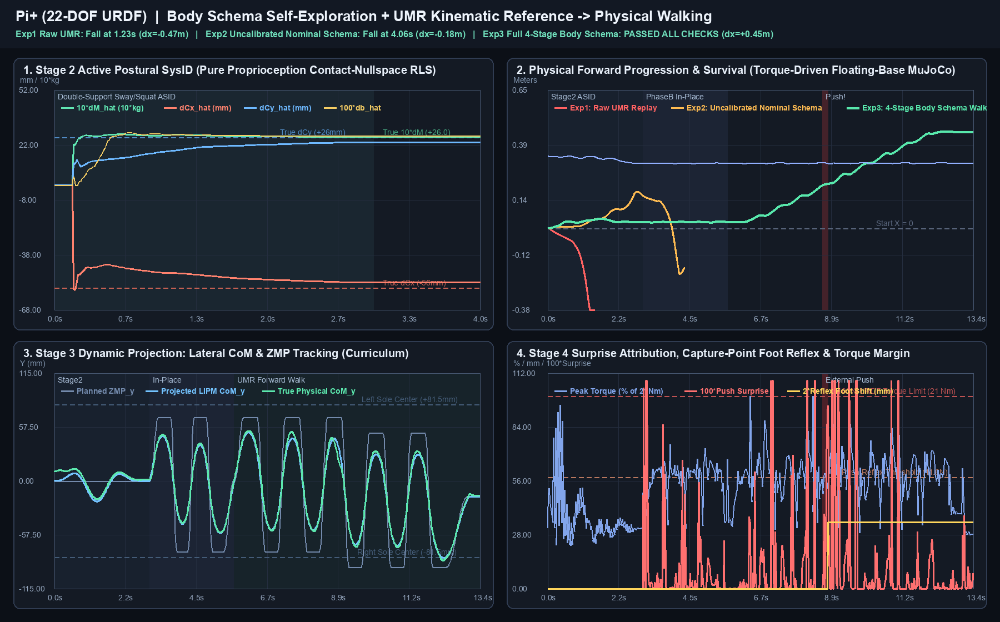
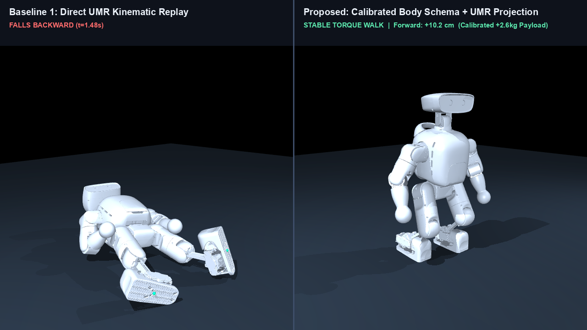
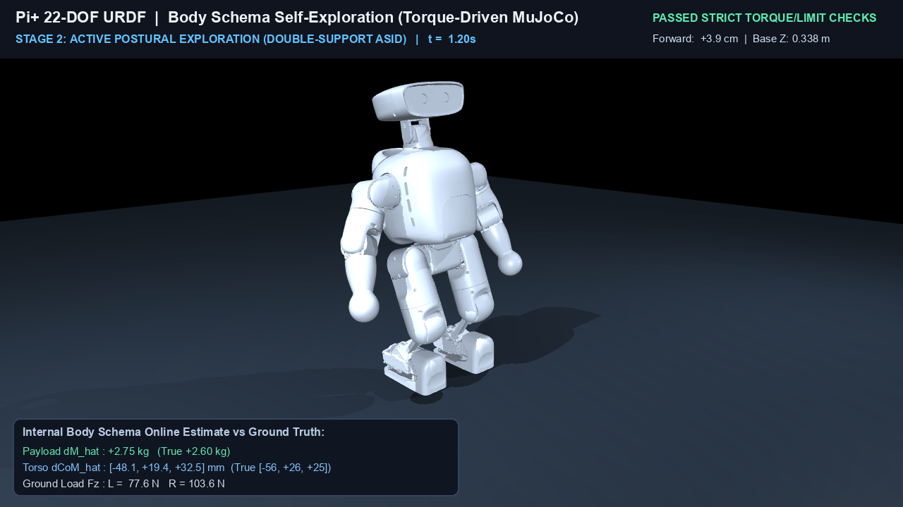
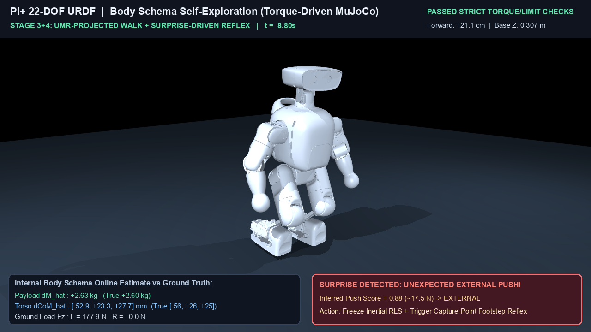

# Pi+ (22-DOF URDF) 身体图式自探索 + 运动学参考 → 真实物理可行步态

> **严格诚实物理仿真约束**：所有实验均在 **MuJoCo 浮动基座纯力矩控制**下运行（`base_externally_stabilized = False`，无基座外力托举、无 Mocap 焊接、全程 `0 → 13.40 s` 连续单回合零 `qpos` 重置、严格执行 URDF `±21 Nm` 腿部电机力矩限幅与 `7.854 rad/s` 关节角速度限幅；控制器与观测器对真实世界参数 `m_true` 零特权访问）。



## 1. 核心结果与仿真视频

| 预览关键帧 | 说明与视频文件 |
| :---: | :--- |
|  | **A/B 对照视频**：[`outputs/ab_comparison_walk.mp4`](./outputs/ab_comparison_walk.mp4)<br/>左：直接回放 UMR 运动学参考（`1.23 s` 后仰摔倒）与未校准名义 URDF 图式（`4.06 s` 遇推失稳摔倒）；<br/>右：经四阶段身体图式自探索校准后的稳定纯力矩步行（`+0.453 m`）。 |
|  | **完整单回合课程视频**：[`outputs/full_curriculum_walk.mp4`](./outputs/full_curriculum_walk.mp4)<br/>Stage 2（`0 ~ 3.0 s`）：双足不离地多频摇摆/微蹲主动系统辨识（ASID），利用 16 维接触零空间纯本体残差在线标定未知偏载与摩擦。 |
|  | **Stage 3 + Stage 4（`3.0 ~ 13.4 s`）**：原地踏步 4 步 → UMR 引导前向行走 10 步。<br/>在 `t = 8.814 s` 仅凭本体感觉解耦推断出突发外推力 `[+16.44, -14.36] N`（真值 `[+16.0, -15.0] N`），冻结内部质量更新并在 `0.1 ms` 内重投影捕获点落脚点。 |

详细技术推演与审计分析请参见 [`REPORT_CN.md`](./REPORT_CN.md) 与定量汇总 [`outputs/experiment_summary.json`](./outputs/experiment_summary.json)。

---

## 2. 静态运动学图式 vs. 真实物理失配（Sim-to-Real Gap 注入）

- **机器人初始先验（Nominal URDF）**：仅包含 [`assets/PiPlus_S_12L8A0G2H0W_LSE_ZedMini_40V_260908.urdf`](./assets/PiPlus_S_12L8A0G2H0W_LSE_ZedMini_40V_260908.urdf) 给定的 22-DOF 静态运动学拓扑与名义质量（`15.86 kg`），假设零静摩擦、低阻尼（`0.04 Nms/rad`）、无电机延迟与刚性地面。
- **真实物理世界（`TrueWorldConfig`）**：
  - **躯干未知偏心负载**：质量增加 `Δm = +2.60 kg`，躯干局部质心偏移 `Δc = [-56, +26, +25] mm`（侵蚀 Pi+ 仅 `±25 mm` 宽的窄足底支撑裕度）；
  - **执行器与关节损耗**：粘滞阻尼 `0.32 Nms/rad`、库仑静摩擦 `0.14 Nm`，叠加 `6 ms` 一阶电机力矩响应延迟；
  - **柔性地面接触**：`solref = (0.015, 0.95)`；
  - **突发外部冲击**：前向行走中途（右腿摆动期）施加未知水平外推力 `F_push = [+16.0, -15.0, 0.0] N`（持续 `0.18 s`）。

---

## 3. 四阶段递进闭环架构

1. **Stage 1 — 运动学内化与自模型边界审计（[`stage1_kinematic_internalizer.py`](./stage1_kinematic_internalizer.py)）**
   - 对 UMR 人类直立行走参考（[`assets/reference_walk/motion.npz`](./assets/reference_walk/motion.npz)，*“挺直腰杆 · 正常向前走”*）做全身正运动学与名义 ZMP 审计，定位直接回放必摔的四项物理根因（直膝雅可比奇异 `calf = -0.027 rad`、超步幅 `0.659 m > 0.110 m`、初始足底悬空 `+17.2 mm`、单足侧向 ZMP 超界 `88.2 mm > 25.0 mm`）；
   - 提取步频节律与 **10-DOF 上肢摆臂/头部抗相协同谐波（`MotorIntent`）**。
2. **Stage 2 — 迈步前安全态主动姿态标定（[`world_and_schema.py`](./world_and_schema.py)）**
   - 双足贴地不抬脚，在支撑多边形安全盒内激发多频质心摇摆、微蹲与躯干俯仰/横滚试探；
   - 利用双足 12 维接触约束雅可比的 **16 维左零空间投影** $N_c(q)$（$N_c J_c^T = 0$），**无需足底六维力传感器**，仅凭本体编码器、IMU 与电机力矩指令在 `< 3 s` 内通过 RLS 辨识出未知负载与摩擦参数，并通过 `mj_setConst` 在线更新内部显式身体图式 `m_schema`：
     - $\Delta \hat{m} = +2.6317\text{ kg}$（真值 `+2.6000 kg`，误差 `1.2%`）
     - $\Delta \hat{\mathbf{c}} = [-52.9, +23.3, +27.7]\text{ mm}$（真值 `[-56.0, +26.0, +25.0] mm`）
     - $\hat{b} = 0.3086\text{ Nms/rad}$（真值 `0.3200`），$\hat{f}_c = 0.1386\text{ Nm}$（真值 `0.1400 Nm`，误差 `1.0%`）
3. **Stage 3 — 基于校准图式的动力学可行性投影（[`stage3_dynamic_projector.py`](./stage3_dynamic_projector.py)）**
   - 基于更新后的 `m_schema` 求解精确三对角边值 LIPM/捕获点轨迹，自动生成躯干前倾 `+4.83°` 与横滚 `+1.16°` 补偿角偏置，结合防奇异屈膝全身微分 IK（`calf >= 0.38 rad`）与 UMR 上肢摆臂协同。
4. **Stage 4 — 课程式迈步与“惊奇驱动（Surprise-Driven）”闭环更新（[`stage4_surprise_controller.py`](./stage4_surprise_controller.py)）**
   - 全程使用带摩擦锥、足底 CoP 与 `±21 Nm` 力矩硬约束的全身逆动力学 OSQP；
   - 由双足摇摆辨识平滑过渡至**原地踏步 4 步**，再进入 **UMR 引导前向行走 10 步**；遭遇突发外推时通过单边腿部雅可比接触力与浮动基座牛顿残差解耦实现 `EXTERNAL_PUSH_REFLEX` 归因与 `0.1 ms` 在线捕获点落脚点外展重投影。

---

## 4. 三组受控物理实验定量对比

| 实验组 | 通过校验 | 存活时长 | 前向位移 | 侧向漂移 | 最大倾角 | 最大速度占限幅比 |
| :--- | :---: | :---: | :---: | :---: | :---: | :---: |
| **Exp 1：直接回放 UMR 运动学参考**（[`exp1_report.json`](./outputs/exp1_report.json)） | 否（后仰摔倒） | `1.228 s` | `-0.4735 m` | `-0.0342 m` | `77.40°` | `1.607` |
| **Exp 2：未校准名义 URDF 图式**（[`exp2_report.json`](./outputs/exp2_report.json)） | 否（遇推失稳摔倒） | `4.064 s` | `-0.1836 m` | `+0.1801 m` | `177.71°` | `1.948` |
| **Exp 3：完整四阶段身体图式自探索**（[`exp3_report.json`](./outputs/exp3_report.json)） | **是（`PASSED`）** | **`13.396 s`** | **`+0.4527 m`** | **`-0.0251 m`** | **`9.48°`** | **`0.919`** |

---

## 5. 快速复现（跨平台自包含，无需外部路径依赖）

```bash
pip install -r requirements.txt

# 1. 运行三组对照 MuJoCo 物理仿真实验
OMP_NUM_THREADS=1 OPENBLAS_NUM_THREADS=1 python run_experiments.py

# 2. 渲染四面板遥测仪表盘与两段 MuJoCo 对比视频
python render_results.py
```
