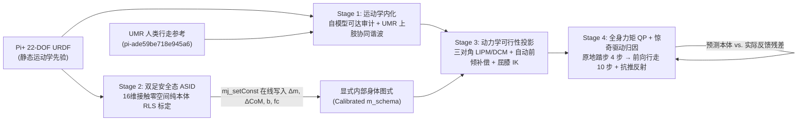

# Pi+ (22-DOF URDF) 身体图式自探索 + 运动学参考物理步态实验报告

## 1. 研究切入点：给定 URDF 后，身体图式自探索到底在学什么？

给定官方 `PiPlus_S_12L8A0G2H0W_LSE_ZedMini_40V_260908.urdf` 后，机器人已经拥有**静态运动学图式**（连杆长度、关节轴向、限位与几何包络已知）；而人类行走视频重定向（UMR）提供了**纯运动学参考**（看起来像走路的关节角变化序列，不含地面反作用力、力矩限幅与动量平衡约束）。

身体图式自探索（Body Schema Self-Exploration）在本实现中补齐的是 URDF 中缺失或失真的**显式动力学图式与接触图式**：
1. **惯量与质心失配**：未知负载质量 $\Delta m$ 与躯干三维质心偏移 $\Delta \mathbf{c}_{\text{torso}}$；
2. **关节传递损耗**：粘滞阻尼 $b$、库仑静摩擦 $f_c$ 及执行器响应延迟；
3. **单双足接触转换与外部扰动归因**：区分“内部模型偏差”与“突发外部推力冲击”，驱动在线捕获点（Capture Point / DCM）落脚点重投影。

---

## 2. 四阶段架构设计与数学机理

### 2.1 Stage 1：运动学参考审计与高层运动意图提取（`stage1_kinematic_internalizer.py`）
对 UMR 参考动作 `pi-ade59be718e945a6`（*“挺直腰杆 · 正常向前走”*，150 帧 @ 30 fps）在 Pi+ URDF 上做逐帧全身正运动学与名义 ZMP 审计（结果见 [`outputs/stage1_kinematic_audit.json`](./outputs/stage1_kinematic_audit.json)）：
- **最小膝关节屈曲角**：`-0.027 rad`（直膝锁死奇异，雅可比条件数恶化）；
- **单步原始摆腿行程**：`0.659 m`（超出 Pi+ `0.282 m` 腿长在安全屈膝下的可达上限 `0.110 m`）；
- **初始接触悬空**：`t = 0` 双足底中心离地 `+17.2 mm`；
- **单足期侧向名义 ZMP 误差**：`88.2 mm`（超出足底半宽 `25.0 mm` 达 3.5 倍）。

系统不再盲目跟踪不可行的下肢关节角，而是从反相髋俯仰过零点提取名义步频周期（`0.622 s`），并对 10 个上肢关节（双臂 8-DOF + 头部 2-DOF）提取步态相位 $\phi \in [0, 2\pi)$ 锁定的傅里叶一阶协同谐波。

### 2.2 Stage 2：无足底力传感器的接触零空间主动辨识（`world_and_schema.py`）
在双足贴地支撑（`0 ~ 3.0 s`）安全边界内，机器人全身动力学方程为：

$$M(q)\ddot{q} + h(q,\dot{q}) + b\dot{q} + f_c\tanh(\dot{q}/\epsilon) = S^T\tau + J_c(q)^T w_c$$

其中双足底 6D 接触旋量 $w_c \in \mathbb{R}^{12}$ 未知（不假设配备昂贵的足底六维力传感器）。对堆叠接触雅可比 $J_c(q) \in \mathbb{R}^{12 \times 28}$ 做奇异值分解，取其 **16 维正交左零空间** $N_c(q) \in \mathbb{R}^{16 \times 28}$（$N_c J_c^T \equiv 0$），左乘动力学方程即可完全消去地面接触反力 $w_c$：

$$N_c(q)\left(S^T\tau - \text{ID}_{\text{nom}}(q,\dot{q},\ddot{q})\right) = N_c(q)\,\Phi(q,\dot{q},\ddot{q})\,\theta$$

通过多频躯干摇摆、微蹲、俯仰/横滚与手臂摆动充分激励线性动量与角动量耦合，6 维未知参数 $\theta = [\Delta m, \Delta p_x, \Delta p_y, \Delta p_z, \Delta b, f_c]^T$ 在 `< 3 s` 内快速收敛：

| 参数 | 名义初值 | 真实世界值 | 在线辨识值 | 误差 |
| :--- | :---: | :---: | :---: | :---: |
| $\Delta m$ | `0.00 kg` | `+2.6000 kg` | **`+2.6317 kg`** | `1.2%` |
| $\Delta c_x$ | `0.0 mm` | `-56.0 mm` | **`-52.9 mm`** | `3.1 mm` |
| $\Delta c_y$ | `0.0 mm` | `+26.0 mm` | **`+23.3 mm`** | `2.7 mm` |
| $\Delta c_z$ | `0.0 mm` | `+25.0 mm` | **`+27.7 mm`** | `2.7 mm` |
| $b$ | `0.040 Nms/rad` | `0.3200 Nms/rad` | **`0.3086 Nms/rad`** | `3.6%` |
| $f_c$ | `0.000 Nm` | `0.1400 Nm` | **`0.1386 Nm`** | `1.0%` |

### 2.3 Stage 3：动力学可行性投影（`stage3_dynamic_projector.py`）
- **姿态自补偿**：根据标定后全身质心的后移与左偏，自动注入 `+4.83°` 躯干前倾角与 `+1.16°` 横滚偏置，使骨盆保持在腿部工作空间中心的同时将真实质心投影回支撑多边形中心；
- **精确离散 LIPM 边值求解**：在分段 $C^2$ 连续 ZMP 轨迹上以 `O(N)` 追赶法精确求解 $\ddot{x} - \omega_0^2 x = -\omega_0^2 p_{\text{zmp}}$；
- **分支连续屈膝全身 IK**：强制 `calf_joint >= 0.38 rad` 远离直膝奇异，并融合 UMR 步态相位上肢摆臂协同。

### 2.4 Stage 4：全身力矩 QP 与惊奇驱动在线反射（`stage4_surprise_controller.py`）
- **悬空脚幻影接触力防护**：在双足规划期实时校验本体正运动学相对足底高度差，若即将落地的摆动脚仍高于支撑脚 `> 3.5 mm`，则将其接触旋量约束为零并施加平滑下压导引，杜绝双足切换瞬间的“空中借力”；
- **纯本体接触力与外部推力解耦观测**：利用每条腿独立的 $6 \times 6$ 关节雅可比结合单边摩擦锥投影推断真实足底接触反力 $\hat{w}_L, \hat{w}_R$，再代入浮动基座前三行牛顿方程分离出作用在躯干上的未知外部水平推力 $\hat{\mathbf{F}}_{\text{ext}}$；
- **惊奇归因与 `0.1 ms` 落脚点重投影**：前向行走第 4 步（`t = 8.64 ~ 8.82 s`）施加 `[+16.0, -15.0, 0.0] N` 未知外推力时，监测器在 `t = 8.814 s` 识别出持续且与捕获点偏移方向一致的推力残差 `[+16.44, -14.36] N`，触发 `EXTERNAL_PUSH_REFLEX`：冻结内部惯量辨识并在 `0.1 ms` 内将右脚目标落点外展调整 `[+4.1, -16.7] mm` 同时重解剩余 LIPM 轨迹，使机器人在不超 `21 Nm` 力矩限幅的前提下平稳恢复步态。
